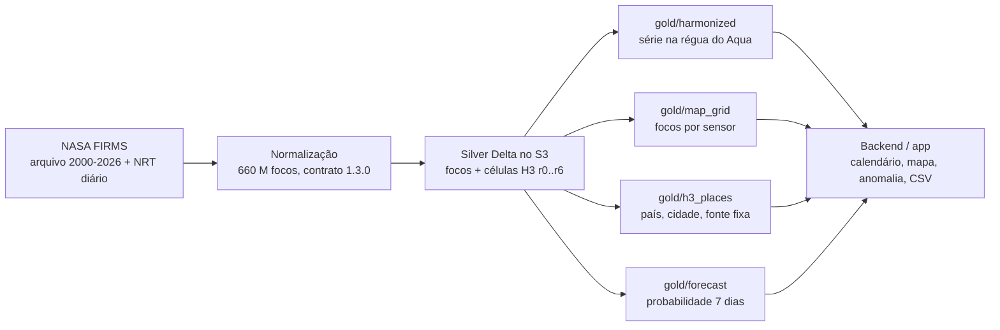

# Fire Atlas no Space Apps 2026: o que o projeto faz e o que mostrar

Desafio: [Harmonization of MODIS and VIIRS Hot Spots](https://www.spaceappschallenge.org/2026/challenges/modis-and-viirs-hot-spots/). Ele pede um calendário de atividade de fogo de 2000 até hoje em que «o sensor de origem deixe de importar», com seleção de área e período, anomalia contra a mediana histórica e download em CSV.

## A ideia em uma frase

Cinco satélites viram fogo de jeitos diferentes ao longo de 26 anos. Pusemos todos na régua de um só, o MODIS Aqua, medimos o erro dessa conversão contra o próprio Aqua e entregamos a série pronta para o calendário, atualizada todo dia.

## Do dado bruto ao calendário

| Camada | O que é | Por que importa no pitch |
|---|---|---|
| Bronze | CSVs originais do FIRMS (62 arquivos) e cada execução diária arquivada | Rastreabilidade: dá para refazer tudo do zero. |
| Normalização | 660 milhões de focos validados, sem descartar nada em silêncio; valores impossíveis viram vazio com registro | Dado limpo e auditável; roda em máquina comum (DuckDB fora da memória). |
| Silver | Focos normalizados com hexágonos H3 de 7 tamanhos | Base única para todas as saídas. |
| `gold/harmonized` | Série diária por hexágono e nível de zoom, na régua do Aqua | **É a resposta ao desafio.** |
| `gold/map_grid` | Focos originais por sensor | O "antes" da harmonização, para comparar. |
| `gold/h3_places` | Continente, país, cidade mais próxima e marca de fonte fixa (flare/vulcão) | Busca por lugar e filtro de falsos fogos. |
| `gold/forecast` | Probabilidade de foco nos próximos 7 dias por hexágono | Diferencial: do histórico para o alerta. |
| Job diário (AWS) | Às 10:00 e 14:00 UTC busca o NRT, atualiza silver, previsão, lugares e harmonização | O calendário está sempre atualizado. |

## A harmonização (o centro do pitch)

**O problema.** Contados ingenuamente, os focos sobem de 3,1 milhões (2003) para 27,6 milhões (2024) por ano. Isso não é mais fogo: são satélites melhores e mais numerosos. O VIIRS (desde 2012) vê fogos pequenos que o MODIS não via, e somar satélites conta o mesmo fogo várias vezes.

**A régua.** A série responde: «quanto o MODIS Aqua, na sua órbita normal (2003–2019), teria registrado nesta área?». Escolhemos o Aqua porque é o único alvo que dá para conferir com uma observação real.

**Como cada dia é calculado:**
- 2002 a 2019, com o Aqua funcionando: o próprio Aqua.
- Depois de 2019, quando a órbita dele muda: os satélites VIIRS convertidos para a régua do Aqua.
- 2000 a meados de 2002, só com o Terra: o Terra convertido, marcado como «menos confiável».
- Dia em que um satélite falhou: ele sai do cálculo, em vez de virar zero.

**Como se converte** (versões 0.1 a 0.3):
1. Uma curva (v0.2) ou um modelo de detecção XGBoost (v0.3) estima, foco a foco, a chance de o Aqua também ter visto aquele fogo. O que mais pesa é a potência do fogo (FRP), seguida de localização, horário da passagem e tamanho do pixel.
2. Um fator regional (região × mês) corrige o que sobra. Regiões com poucos dados são puxadas para a média da região maior.
3. Cadeia de satélites: NOAA-20 calibrado contra o Suomi-NPP e NOAA-21 contra o NOAA-20. Assim a entrada de um satélite novo não cria salto.

**Como provamos** (protocolo definido antes de olhar o teste):
- anos reservados que o ajuste nunca leu;
- validação por blocos de anos;
- um teste de extrapolação rodado uma vez só.

Erro = diferença contra o Aqua real, por região de ~87 mil km² e por mês:

| Período da série | Erro | Observação |
|---|---:|---|
| Sem harmonizar (soma dos satélites) | ~800% | O problema original. |
| 2000–2002 (Terra) | ~23% | Marcado como menos confiável. |
| 2002–2019 | 0 por definição | É o próprio Aqua. |
| 2020 em diante (VIIRS, v0.2) | ~11% | — |
| 2020 em diante (VIIRS, v0.3 com modelo de detecção) | ~10% | Validação cruzada. |

- O total fica a menos de 1% do Aqua: não há viés, só dispersão.
- A ordem dos meses mais ativos em cada região se mantém (correlação 0,97).
- Dois VIIRS idênticos, com 50 minutos de diferença, já discordam cerca de 7% entre si. Esse é praticamente o piso possível.

**Slides que sugerimos:**
1. Gráfico «antes x depois»: as linhas brutas de cada satélite subindo em degraus contra a série harmonizada, plana nas trocas de satélite.
2. O que explica o «um satélite viu e o outro não»: potência do fogo, posição, horário e tamanho do pixel.
3. Tabela de erro por período, com o aviso de 2000–2002.
4. Calendário de uma região (mês × ano com rampa de cor) e a anomalia do mês atual contra a mediana de 2002-07 em diante.

## Os extras

- **Previsão de 7 dias.** XGBoost testado em 2023–2026 (874 milhões de linhas, nunca vistas no treino).
  - PR-AUC 0,568, contra 0,496 da regra «onde queima continua queimando» e 0,363 da média histórica.
  - Calibrado: quando diz 45%, acontece ~44%.
  - Vale para hexágonos que já tiveram fogo. Um teste para fogo em lugar novo deu sinal fraco (só 28% dessas primeiras detecções têm fogo perto) e ficou fora do produto.
- **Fontes fixas.** Hexágonos em que o FIRMS classifica a maioria dos focos como vulcão, flare de petróleo ou plataforma ficam marcados e podem ser escondidos no mapa. O filtro pega Iraque, Irã e Venezuela (flares) e Kilauea e Nyiragongo (vulcões), sem esconder o fogo de turfa da Indonésia.
- **Lugar.** País, continente e cidade mais próxima por hexágono, para busca e rótulos.

## Decisões que valem citar

| Decisão | Por quê |
|---|---|
| Sensores nunca somados | Somar conta o mesmo fogo várias vezes e cria degraus falsos. |
| Unidade «hexágono ativo por meio dia» | Reduz o efeito de 1 fogo virar vários pontos VIIRS. |
| Régua = Aqua (2003–2019) | Única referência observável para conferir o resultado. |
| Teste reservado, rodado uma vez | Os números do pitch não foram ajustados olhando o teste. |
| Ausência de foco ≠ ausência de fogo | Um dia sem satélite é «sem dado», não zero. |
| Tudo no S3 em Delta, com job diário | Reprodutível, versionado e sempre atualizado. |

## Limites para dizer com honestidade

- A unidade é «hexágonos ativos na régua do Aqua», não número de incêndios nem área queimada.
- Em áreas pequenas (~1.800 km² por mês) o erro fica perto de 26–33%. Em regiões com pouquíssimo fogo passa de 100%, então o app mostra aviso.
- Fogos pequenos que o Aqua nunca enxergaria não aparecem na régua.
- Depois de 2019 não há como reconferir contra o Aqua; o VIIRS fica de 1% a 3% abaixo dele desde 2023, e não sabemos separar se é deriva do Aqua ou da cadeia.
- Nenhum limiar de aceite científico foi aprovado: os resultados são medidos e reportados, não certificados.

Detalhes: [harmonização](harmonization.md), [previsão](ml-forecast.md), [job diário](daily-ingest.md), [lugares e fontes fixas](gold-places.md).
